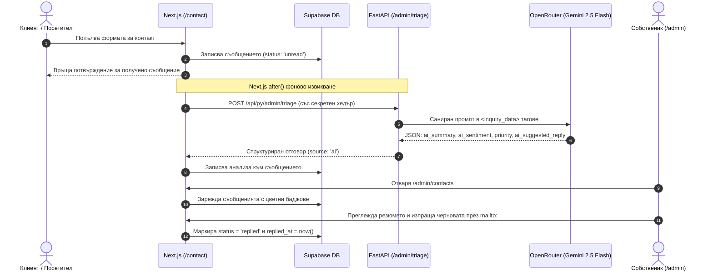

# Стъпка 15: Owner Admin Control Plane, AI Triage & Analytics

> **Статус**: 🟢 Завършена и слята в `main` (Pull Request #18, commit `e63334e`)  
> **Дата на завършване**: 19 октомври 2026 г.  
> **Основни компоненти**: `/admin`, `/admin/login`, `/admin/contacts`, FastAPI AI Triage Service, Supabase pgvector & Analytics  
> **Референтни документи**: [`ROADMAP.md`](../../ROADMAP.md), [`AGENTS.md`](../../AGENTS.md), [`docs/README.md`](../README.md)

---

## 1. Резюме и Архитектурни цели

С реализирането на **Стъпка 15**, SmartScan Stay получава завършен, автономен и високотехнологичен **Административен контролен панел на собственика (Owner Admin Control Plane & Analytics)**. Модулът позволява пълен оперативен контрол над входящите запитвания от формата за контакт, директорията на хазяите, управлението на пробните периоди (trials) и абонаментите, както и детайлна системна аналитика в реално време.

### Основни инженерни стълбове:
1. **Строга сигурност без `middleware.ts` (Strict No-Middleware Architecture)**:
   - В съответствие с глобалните стандарти на проекта и защита от уязвимости (CVE-2025-29927), целият защитен контур на администратора се управлява в **Data Access Layer (DAL)** на ниво React Server Components.
   - Всички клиентски заявки се проверяват директно срещу сесия от `@supabase/ssr` или криптографски валидиран сесиен токен с ограничена валидност и защита срещу бъдещи времеви отпечатъци.
   - **Елиминиране на привилегии от `user_metadata`**: Потребителски-модифицируемият атрибут `user_metadata` е категорично изключен от логиката за достъп. Права се присъждат единствено чрез:
     - Базата данни: `public.hosts.is_platform_admin = true`;
     - Сървърно-контролирания обект `app_metadata.is_platform_admin = true`;
     - Конфигуриран бял списък от имейли в променливата на средата `ADMIN_EMAILS`.
2. **AI Triaging & Анализ на запитванията (Gemini 2.5 Flash + Heuristic Fallback)**:
   - Интеграция с модела `google/gemini-2.5-flash` през OpenRouter за светкавичен анализ (под 800ms) на получените запитвания.
   - AI триажът генерира:
     - `ai_summary`: сбито резюме на проблема или търговския интерес;
     - `ai_sentiment`: сантимент (`positive`, `neutral`, `frustrated`, `urgent`);
     - `priority`: прецизно изчислен приоритет (`low`, `normal`, `high`, `urgent`);
     - `ai_suggested_reply`: професионална готова чернова на отговор на съответния език на клиента (български, немски, английски, гръцки и др.).
   - **Защита от Prompt Injection**: Нулева латентност без междинен LLM guardrail. Входните данни преминават през строга Regex дезинфекция и XML escaping, след което се изолират в `<inquiry_data>` тагове.
   - **Детерминиран локален fallback**: При липса на връзка с AI бекенда или прекъсване на мрежата, системата мигновено прилага локален алгоритъм за класификация и шаблонни многоезични чернови (`contactTriageFallback.ts`).
3. **Фоново асинхронно стартиране чрез `after()`**:
   - При изпращане на съобщение през формата за контакт (`/contact`), триажът се планира чрез новия примитив `after()` от `next/server`. Това осигурява незабавен отговор към клиента, като триажът се извършва на заден план без риск от прекъсване на изпълнението в serverless среди.
4. **Управление на запитванията (Inbox Management)**:
   - Цветни отличителни баджове за всички 4 нива на приоритет:
     - 🔴 **Спешен (Urgent)**: Червен индикатор;
     - 🟠 **Висок (High)**: Кехлибарен / оранжев индикатор;
     - 🔵 **Нормален (Normal)**: Син индикатор;
     - ⚪ **Нисък (Low)**: Цинков / сив индикатор.
   - **Персонализиран `DeleteConfirmModal`**: Изтриването на съобщения използва елегантен модален диалог, изграден върху преизползваемия компонент [`Dialog.tsx`](file:///d:/myProjects/smart_scan/frontend/src/components/ui/Dialog.tsx) с фон с размазване (backdrop blur) и достъпни контроли (замества браузърния `window.confirm`).
   - **Изолирани чернови на отговори**: Черновите се съхраняват в речник по ID на запитване (`draftsByMessageId`), така че при превключване между клиенти текстът не се губи и не се смесва.
   - **Директен отговор**: Записване на отговора в базата с маркиране на статус `replied` и час `replied_at`, съчетано с 1-клик `mailto:` линк за изпращане през системния имейл клиент.
5. **Директория на хазяите & Управление на обектите**:
   - Ясно разграничаване на тестовия админ от реалните клиенти: метриката `totalHosts` отчита единствено клиентите, а тестовият админ в таблицата е означен с бадж `Тестов Админ (Owner)`.
   - 1-клик удължаване на пробния период (+7 дни) с Zod валидация на параметрите и защита срещу невалидни дати (`NaN`).
   - Превключване на активността на обектите (`is_active` в таблица `spaces`).
6. **Тестов вход за разработчици**:
   - Лесни и запомнящи се идентификатори за тестване на локална среда:
     - **Потребител**: `admin` (или `admin@test.bg`)
     - **Парола**: `admin` (или `admin123`)
   - Автоматично осигуряване (provisioning) на потребителя в Supabase Auth и `public.hosts` с `is_platform_admin = true`.
   - Възможност за изрично блокиране на тестовия вход чрез променлива `ALLOW_TEST_ADMIN_LOGIN=false`.

---

## 2. Архитектура на файловата структура

Модулът следва стриктните принципи за модулност, изолация и лимит на файловете под 300 реда (Правило 6):

```text
d:\myProjects\smart_scan/
├── backend/app/features/admin_triage/
│   ├── __init__.py
│   ├── router.py                      # FastAPI рутер /api/py/admin/triage със SlowAPI и таен ключ
│   ├── schemas.py                     # Pydantic v2 схеми с гъвкав UUID парсинг
│   └── service.py                     # OpenRouter интеграция с Gemini 2.5 Flash и asyncio.to_thread
│
├── frontend/src/
│   ├── app/
│   │   └── admin/
│   │       ├── layout.tsx             # Наследява общия лек лейаут
│   │       ├── page.tsx               # Преглед на таблото (Dashboard Snapshot)
│   │       ├── login/
│   │       │   └── page.tsx           # Страница за автентикация на админа
│   │       └── contacts/
│   │           └── page.tsx           # Директен път към входящата кутия със запитвания
│   │
│   ├── features/admin/
│   │   ├── actions/
│   │   │   ├── adminAuthActions.ts    # Вход с парола, 1-клик тестов вход, изход
│   │   │   ├── adminContactActions.ts # Zod валидирани действия за статус, отговор, триаж, изтриване
│   │   │   ├── adminHostActions.ts    # Удължаване на trial (+7 дни), паузиране/активиране на обект
│   │   │   └── contactTriageFallback.ts # Детерминирани локални евристични шаблони за триаж
│   │   │
│   │   ├── components/
│   │   │   ├── AdminNavbar.tsx        # Навигация с табове, индикатори и профил
│   │   │   ├── AdminKpiGrid.tsx       # 13 аналитични метрики (MRR, чатове, сканирания)
│   │   │   ├── AdminLoginCard.tsx     # Форма за вход с опция за бърз 1-клик тестов достъп
│   │   │   ├── AdminHostsView.tsx     # Директория на хазяите с управление на пространства
│   │   │   ├── AdminContactsView.tsx  # Главен изглед за входящи съобщения
│   │   │   ├── ContactFilterBar.tsx   # Търсене, филтри по статус/приоритет, демо данни
│   │   │   ├── ContactInquiryListItem.tsx # Списък със запитвания с пълна WAI-ARIA достъпност
│   │   │   ├── ContactInquiryInspector.tsx# Детайлен инспектор на избраното съобщение
│   │   │   ├── ContactAiTriageCard.tsx# AI табло с резюме, сантимент и бутон за анализ
│   │   │   ├── ContactReplyComposer.tsx   # Редактор на отговора с копиране и mailto връзка
│   │   │   ├── DeleteConfirmModal.tsx # Персонализиран модал за потвърждение на изтриване
│   │   │   └── FeedbackBanner.tsx     # Достъпни банери за обратна връзка
│   │   │
│   │   ├── hooks/
│   │   │   └── useContactInquiryActions.ts # Капсулирана бизнес логика и async state
│   │   │
│   │   ├── types/
│   │   │   └── adminTypes.ts          # Строги интерфейси за KPI, статус, роли и отговори
│   │   ├── AdminDashboardPage.tsx     # Координиращ главен компонент на таблото
│   │   └── index.ts                   # Публичен Barrel Export
│   │
│   └── lib/auth/
│       ├── adminDal.ts                # Тънък DAL слой: getAuthenticatedAdmin()
│       ├── adminSession.ts            # Криптографски токени, HMAC, expiry и безопасен парсинг
│       └── adminSnapshot.ts           # Агрегация на метриките и директорията от базата
│
└── supabase/migrations/
    └── 20261018000001_admin_panel_and_analytics.sql # База данни миграция
```

---

## 3. База данни и Миграции

Миграцията [`supabase/migrations/20261018000001_admin_panel_and_analytics.sql`](../../supabase/migrations/20261018000001_admin_panel_and_analytics.sql) разширява схемата на SmartScan Stay със следните елементи:

### А. Разширение на таблица `public.hosts`
```sql
ALTER TABLE public.hosts
ADD COLUMN IF NOT EXISTS is_platform_admin BOOLEAN NOT NULL DEFAULT false;

COMMENT ON COLUMN public.hosts.is_platform_admin IS 
  'Определя дали хазяинът е главен администратор / собственик на платформата SmartScan Stay.';
```

### Б. Разширение на таблица `public.contact_messages`
```sql
ALTER TABLE public.contact_messages
ADD COLUMN IF NOT EXISTS admin_reply TEXT NULL;

COMMENT ON COLUMN public.contact_messages.admin_reply IS 
  'Текстът на изпратения отговор от платформата към подателя на съобщението.';
```

### В. Нова аналитична таблица `public.space_analytics_events`
Таблицата записва събития от гостуващи сесии за агрегиране на KPI метриките:
```sql
CREATE TABLE IF NOT EXISTS public.space_analytics_events (
  id UUID PRIMARY KEY DEFAULT gen_random_uuid(),
  space_id UUID NOT NULL REFERENCES public.spaces(id) ON DELETE CASCADE,
  event_type TEXT NOT NULL CHECK (event_type IN ('qr_scan', 'chat_message', 'wifi_copy', 'resolved_query')),
  guest_session_id TEXT NULL,
  metadata JSONB NOT NULL DEFAULT '{}'::jsonb,
  created_at TIMESTAMPTZ NOT NULL DEFAULT now()
);

-- Индекси за бърза агрегация
CREATE INDEX IF NOT EXISTS idx_space_analytics_space_event 
  ON public.space_analytics_events (space_id, event_type);

CREATE INDEX IF NOT EXISTS idx_space_analytics_created 
  ON public.space_analytics_events (created_at DESC);
```

---

## 4. AI Triaging пайплайн (Архитектурен поток)

Следният диаграм показва пълния жизнен цикъл на обработка на едно клиентско запитване:



---

## 5. Ръководство за тестване и работа

### Вход в административния панел
1. Отворете в браузъра адрес: [`http://localhost:3000/admin/login`](http://localhost:3000/admin/login).
2. Натиснете бутона **„⚡ Бърз вход като Тестов Админ“** (на разположение в dev режим).
3. Системата автоматично ще удостовери сесията и ще ви пренасочи към [`/admin`](http://localhost:3000/admin).
4. Алтернативно, можете да въведете стандартните тестови данни:
   - **Имейл**: `admin` (или `admin@test.bg`)
   - **Парола**: `admin` (или `admin123`)

### Тестване на входящата поща (Inbox)
1. В горния навбар преминете на таб **„Запитвания“** (`/admin/contacts`).
2. Ако няма налични запитвания, кликнете върху бутона **„+ Демо запитвания“** горе вдясно.
3. Системата автоматично ще генерира 3 реалистични многоезични казуса:
   - 🇧🇬 Калоян Димитров (Созопол, 6 къщи) — интерес към A5 табелки и зимно паузиране;
   - 🇩🇪 Markus Weber (Тирол, 3 апартамента) — въпрос за немски език и аудио бележки;
   - 🇬🇷 Elena Papadopoulou (Халкидики, вила) — спешен въпрос за PIN код на сейфа.
4. В списъка вляво кликнете върху запитване:
   - Веднага виждате цветния приоритетен бадж (🔴 Urgent, 🟠 High, 🔵 Normal);
   - Натиснете **„🤖 Анализирай с Gemini Flash“** — системата ще генерира резюме, сантимент и готова чернова;
   - Натиснете **„Зареди AI черновата“**, за да попълните полето за отговор;
   - Можете да тествате бутона **„Изтрий“** — ще се отвори елегантният `DeleteConfirmModal` за потвърждение.

### Тестване на директорията с хазяи
1. Преминете на таб **„Хазяи & Обекти“**.
2. Обърнете внимание, че метриката **„Хазаи“** показва броя на реалните клиенти, а профилът на админа е маркиран като `Тестов Админ (Owner)`.
3. Натиснете бутона **„+7 дни Trial“** за даден хазяин, за да удължите пробния период с 1 седмица.

---

## 6. Проверка на качеството и верификация

Всички проверки бяха успешно преминати преди сливането в `main`:

| Проверка | Команда | Резултат |
| :--- | :--- | :--- |
| **TypeScript компилация** | `npx tsc --noEmit` | ✅ 0 грешки (Clean Exit 0) |
| **ESLint правила** | `npm run lint` | ✅ 0 предупреждения / 0 грешки |
| **Production Build** | `npm run build` | ✅ Успешен build за 16.2s (13/13 маршрута) |
| **Python Syntax Check** | `python -m py_compile` | ✅ 0 грешки в backend модулите |
| **Vercel Deployment** | Автоматичен CI/CD деплой | ✅ *Deployment has completed (Success)* |
| **CodeRabbit Review** | Автоматичен одит на сигурността | ✅ Всички препоръки са адресирани |
