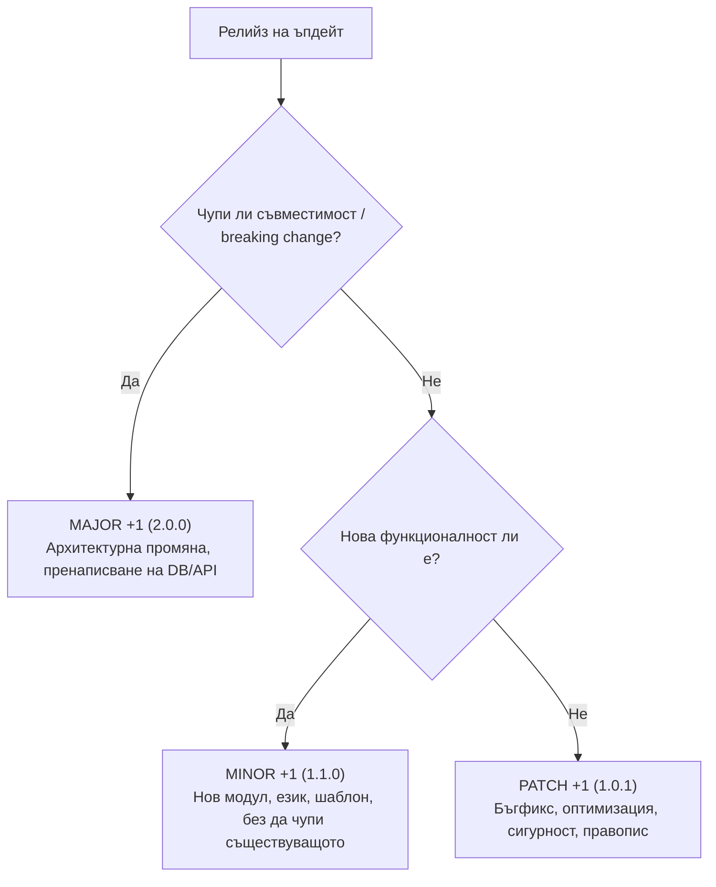

# SmartScan Stay — Ръководство за версиониране и релийз политика (Versioning & Release Guide)

Този документ описва официалния стандарт за софтуерно версиониране, структурата на релийзите и процедурата за пускане на ъпдейти в **SmartScan Stay**.

---

## 1. Официален стандарт: Semantic Versioning (SemVer 2.0.0)

SmartScan Stay следва стриктно световния стандарт **Semantic Versioning 2.0.0** ([semver.org](https://semver.org/spec/v2.0.0.html)):

$$\mathbf{MAJOR} . \mathbf{MINOR} . \mathbf{PATCH} \quad (\text{Текуща версия: } \mathbf{1.0.0})$$



### 1.1 Значение на трите компонента:

| Компонент | Пример за преход | Кога се повишава? | Примери за SmartScan Stay |
| :--- | :--- | :--- | :--- |
| **MAJOR** | `1.0.0` $\to$ `2.0.0` | **Несъвместими промени (Breaking changes)**: Промяна в съществуващи API ендпойнтове, миграция към нова база данни с несъвместими схеми, генерална промяна в бизнес модела или пълно пренаписване на ядрото. | Смяна на цялостния модел на данните или премахване на основни публични маршрути. |
| **MINOR** | `1.0.0` $\to$ `1.1.0` | **Нова функционалност (Backwards-compatible feature)**: Добавяне на нови модули или възможности, без да се чупи работата на съществуващите потребители. | Добавяне на PMS интеграция (Airbnb iCal sync), нов формат на QR табелка (A6 настолна картичка), добавяне на нови езици за хазяи. |
| **PATCH** | `1.0.0` $\to$ `1.0.1` | **Корекция на грешки (Hotfixes & Bugfixes)**: Оправяне на бъгове, подобрение на скоростта, актуализации по сигурността, козметични стилови корекции. | Оправяне на разместен текст в PWA на малки екрани, корекция на валидация на телефонен номер, ускоряване на SSE връзка. |

---

## 2. Единен източник на истината (Single Source of Truth)

Версията на системата е централизирана и се поддържа синхронизирана в следните файлове:

```text
smart_scan/
├── frontend/
│   ├── package.json              # "version": "1.0.0" (Фронтенд и npm зависимости)
│   └── src/features/dashboard/
│       └── components/
│           └── UserProfileDropdown.tsx  # Визуален етикет за хазяина: SmartScan Stay v1.0.0
│
├── backend/
│   ├── pyproject.toml            # version = "1.0.0" (Бекенд uv / Python пакет)
│   └── app/
│       └── main.py               # app = FastAPI(..., version="1.0.0") (OpenAPI метаданни)
│
├── CHANGELOG.md                  # Пълна история на промените по версии
└── .git/refs/tags/               # Git Release Tags (напр. v1.0.0)
```

---

## 3. Чеклист: Стъпка по стъпка за пускане на нова версия (Release Workflow)

При всеки нов ъпдейт следвайте този точен инженерен протокол:

### Стъпка 1: Определяне на новата версия
- Преценете дали промените са за `PATCH` (`1.0.1`), `MINOR` (`1.1.0`) или `MAJOR` (`2.0.0`).

### Стъпка 2: Обновяване на конфигурационните файлове
1. **Frontend**: Отворете `frontend/package.json` и обновете `"version": "x.y.z"`.
2. **Backend**: Отворете `backend/pyproject.toml` и обновете `version = "x.y.z"`.
3. **FastAPI**: Отворете `backend/app/main.py` и проверете дали `version="x.y.z"` съвпада.
4. **UI Бадж**: В `UserProfileDropdown.tsx` се уверете, че визуалният етикет отразява новата версия.

### Стъпка 3: Документиране в `CHANGELOG.md`
В най-горната част на `CHANGELOG.md` добавете нова секция по стандарта:

```markdown
## [1.1.0] — ГГГГ-ММ-ДД

### ✨ Добавено (Added)
- Описание на новите функционалности...

### 🔄 Променено (Changed)
- Описание на променено поведение...

### 🐛 Поправено (Fixed)
- Списък на отстранените дефекти...

### 🛡️ Сигурност (Security)
- Специфични секюрити пачове...
```

### Стъпка 4: Локална верификация
Преди качване винаги изпълнете задължителните проверки:
```powershell
# 1. Проверка на типовете във фронтенда
cd frontend
npm run typecheck

# 2. Проверка на линтерите в бекенда
cd ../backend
uv run ruff check .
```

### Стъпка 5: Git Commit & Release Tag
```powershell
# 1. Стейджване на промените
git add .

# 2. Създаване на релийз commit
git commit -m "chore: release v1.1.0"

# 3. Създаване на анотиран Git таг
git tag -a v1.1.0 -m "Release v1.1.0 — <кратко описание>"
```

### Стъпка 6: Push към GitHub
```powershell
# Качване на кода и таговете към отдалеченото хранилище
git push origin main
git push origin --tags
```
*След пуш, Vercel и Render автоматично разпознават промените в `main` клона и правят безшевен Zero-Downtime деплой.*

---

## 4. Специфика за тестови срещу реални среди (Stripe & ENV)

- **Версията на кода** (`1.0.0`, `1.1.0` и т.н.) е независима от това дали Stripe работи с `sk_test_...` или `sk_live_...`.
- Кодът остава чист и не съдържа твърдо кодирани продукционни ключове. Превключването от тестови към реални плащания става единствено чрез обновяване на променливите на средата в Render и Vercel без промяна в логиката на кода.
- Подробният план за активиране на реални плащания се намира в:
  👉 `brain/.../production-launch-and-versioning-plan.md`.
